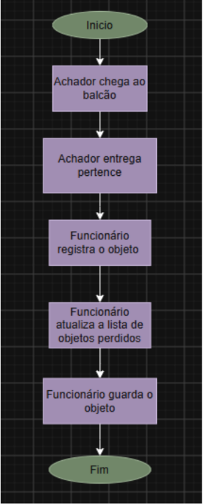
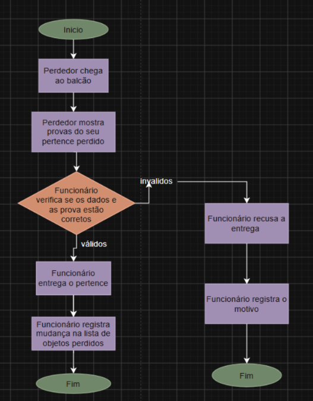
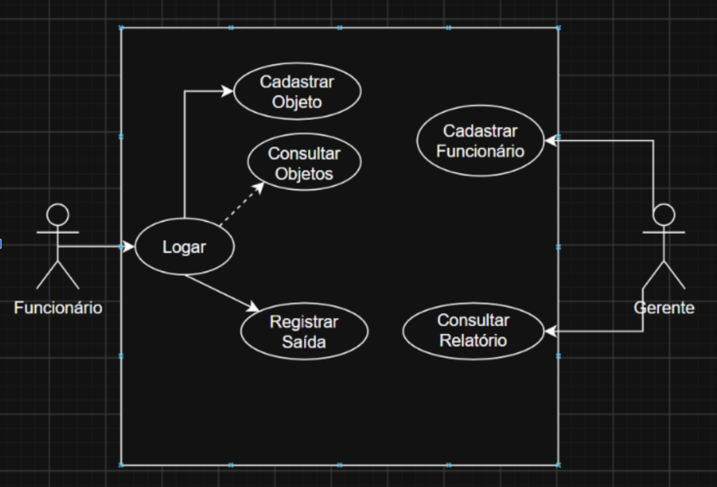
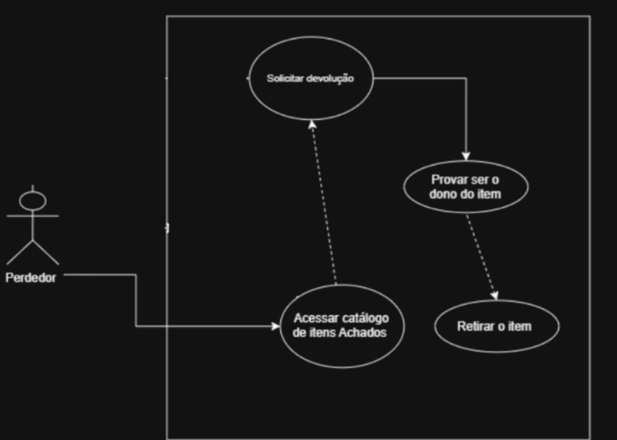

# 🔎 Achados e Perdidos

Sistema proposto para organizar o registro, a consulta e a devolução de objetos encontrados, com foco no ambiente escolar.

## 📌 Sobre o projeto

O **Achados e Perdidos** é um projeto acadêmico desenvolvido por estudantes do curso de Desenvolvimento de Sistemas da Etec Cidade Tiradentes.

A proposta é centralizar em uma plataforma digital o processo de recebimento, armazenamento, consulta e devolução de objetos perdidos, tornando o procedimento mais organizado, prático e seguro.

**Status:** Projeto acadêmico de análise, documentação e prototipação. As funcionalidades descritas representam a proposta do sistema e não significam que todas já estejam implementadas.

## 🎯 Objetivos

* Facilitar a localização de objetos perdidos.
* Organizar o cadastro e o armazenamento dos itens encontrados.
* Permitir a consulta de um catálogo digital.
* Controlar as solicitações e devoluções dos objetos.
* Aumentar a segurança por meio da validação da propriedade.
* Facilitar o acompanhamento dos registros e a emissão de relatórios.

## ⚙️ Funcionalidades previstas

* **Catálogo público:** consulta dos objetos disponíveis.
* **Cadastro de objetos:** registro das informações, características, fotos e local de armazenamento.
* **Solicitação de retirada:** solicitação para recuperar um objeto identificado.
* **Registro de saída:** registro formal da entrega do objeto.
* **Acesso de funcionários:** login para acessar as funções internas.
* **Cadastro de funcionários:** gerenciamento de contas pelo gerente.
* **Relatórios:** consulta dos registros para acompanhamento.
* **QR Code:** acesso facilitado ao catálogo digital.

## 👥 Perfis de usuário

| Perfil                  | Responsabilidades                                                    |
| ----------------------- | -------------------------------------------------------------------- |
| Perdedor                | Consultar o catálogo e solicitar a retirada de um possível pertence. |
| Achador                 | Entregar um objeto encontrado e fornecer informações sobre ele.      |
| Funcionário / Operador  | Cadastrar objetos, verificar informações e registrar devoluções.     |
| Gerente / Administrador | Cadastrar funcionários e consultar relatórios.                       |

## 🔄 Como funciona

1. Uma pessoa encontra um objeto e o entrega no ponto de atendimento.
2. O funcionário registra os dados do item e informa onde ele será armazenado.
3. O objeto fica disponível no catálogo para consulta.
4. A pessoa que perdeu o pertence pesquisa no catálogo, que pode ser acessado por QR Code.
5. Ao identificar um possível objeto, ela solicita a retirada.
6. No balcão, o funcionário confere as informações para validar a propriedade.
7. Se a validação for aprovada, a entrega é registrada e o objeto passa para o status **Devolvido**.

## 🗂️ Organização do projeto

```text
Achados_e_Perdidos/
├── README.md
└── prjAchados-e-Perdidos/
    ├── diagramas/
    ├── fluxogramas/
    ├── telas alta f/
    ├── telas baixa f/
    └── Achados e Perdidos.pdf
```

*Estrutura ilustrativa das pastas principais do projeto.*

## 📐 Documentação do projeto

O material desenvolvido inclui:

* Documento principal do projeto;
* Fluxogramas dos processos de recebimento e retirada;
* Diagramas de casos de uso;
* Descritivos de casos de uso;
* Protótipos de baixa e alta fidelidade;
* Requisitos funcionais e não funcionais;
* Matriz de rastreabilidade.

O documento completo pode ser consultado na pasta do projeto: [`Achados e Perdidos.pdf`](./prjAchados-e-Perdidos/Achados%20e%20Perdidos.pdf).

## 🖼️ Diagramas e fluxogramas

Os arquivos abaixo utilizam caminhos relativos à pasta principal do projeto.

### Fluxogramas

**Recebimento de objeto**



**Retirada de objeto**



### Diagramas de casos de uso

**Funcionários e gerente**



**Pessoa que perdeu o objeto**



## 🧰 Tecnologias e ferramentas

O repositório reúne documentação, diagramas, fluxogramas e protótipos. As tecnologias de implementação devem ser informadas conforme o desenvolvimento efetivamente realizado.

## 👨‍💻 Equipe

Projeto desenvolvido por estudantes da **Etec Cidade Tiradentes**, no curso de **Desenvolvimento de Sistemas**.

* Anderson Lima De Andrade
* Bleda Henrique da Hora Lopes
* Caio Henrique Moraes Ferreira
* Lucas Miguel Vitoria de Oliveira
* Melissa Barbosa Crepaldi
* Nicolas Anderson da Silva Santos
* Luan Evangelista de Souza Carvalho

**Professor orientador:** Prof. Everson

**Local:** São Paulo — SP

**Ano:** 2026

---

Projeto acadêmico desenvolvido com o objetivo de planejar e documentar uma solução digital para organizar o processo de Achados e Perdidos.
